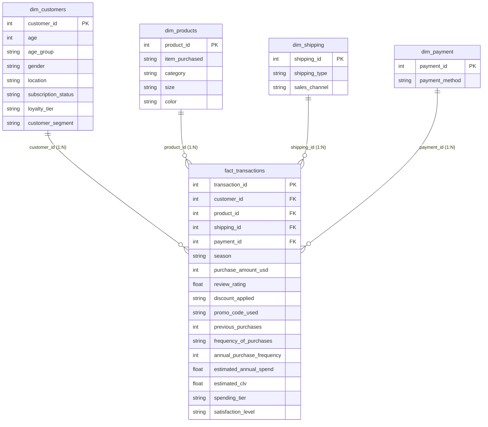

# Power BI Data Model: Star Schema Architecture
**Project:** Retail Consumer Shopping Behavior Analysis  
**Data Model Type:** Kimball-style Dimensional Star Schema  

---

## 1. Overview & Architectural Goals
The data model is structured according to the Star Schema paradigm to deliver:
- Maximum DAX query performance in VertiPaq engine.
- Intuitive drag-and-drop slice-and-dice for business users.
- Clean separation between measurable business events (`fact_transactions`) and qualitative context (`dim_customers`, `dim_products`, `dim_shipping`, `dim_payment`).

---

## 2. Table Definitions & Cardinality

### A. Fact Table: `fact_transactions`
- **Granularity:** One record per individual transaction.
- **Total Rows:** 3,900
- **Primary Key:** `transaction_id`
- **Foreign Keys:**
  - `customer_id` -> `dim_customers.customer_id` (Many-to-One `* : 1`, Single cross-filter)
  - `product_id` -> `dim_products.product_id` (Many-to-One `* : 1`, Single cross-filter)
  - `shipping_id` -> `dim_shipping.shipping_id` (Many-to-One `* : 1`, Single cross-filter)
  - `payment_id` -> `dim_payment.payment_id` (Many-to-One `* : 1`, Single cross-filter)
- **Key Metrics (Measures):** `purchase_amount_usd`, `review_rating`, `previous_purchases`, `estimated_annual_spend`, `estimated_clv`.

### B. Dimension: `dim_customers`
- **Granularity:** One record per unique customer.
- **Attributes:**
  - `customer_id` (Integer PK)
  - `age` (Integer) & `age_group` (18-25, 26-35, 36-50, 51-70)
  - `gender` (Male, Female)
  - `location` (US State)
  - `subscription_status` (Yes, No)
  - `loyalty_tier` (Bronze, Silver, Gold, Platinum)
  - `customer_segment` (K-Means persona)

### C. Dimension: `dim_products`
- **Granularity:** One record per unique item specification.
- **Attributes:**
  - `product_id` (Integer PK)
  - `item_purchased` (e.g. Blouse, Jeans, Dress, Sneakers)
  - `category` (Clothing, Accessories, Footwear, Outerwear)
  - `size` (S, M, L, XL)
  - `color` (25 distinct color shades)

### D. Dimension: `dim_shipping`
- **Granularity:** One record per shipping type / channel.
- **Attributes:**
  - `shipping_id` (Integer PK)
  - `shipping_type` (Store Pickup, Free Shipping, Standard, Next Day Air, Express, 2-Day Shipping)
  - `sales_channel` ('In-Store Pickup' vs 'Online Shipping')

### E. Dimension: `dim_payment`
- **Granularity:** One record per payment method.
- **Attributes:**
  - `payment_id` (Integer PK)
  - `payment_method` (PayPal, Credit Card, Cash, Debit Card, Venmo, Bank Transfer)

---

## 3. Best Practice Settings in Power BI Desktop
1. **Hide Foreign Keys in Fact Table:** Right-click `customer_id`, `product_id`, `shipping_id`, and `payment_id` in `fact_transactions` and choose **Hide in report view** to prevent accidental grouping on the fact table.
2. **Cross-Filter Direction:** Always use **Single** (Dimensions filter Fact). Do NOT use Bi-directional filtering.
3. **Sort By Columns:**
   - Sort `age_group` by an integer sorting index (1: 18-25, 2: 26-35, 3: 36-50, 4: 51-70).
   - Sort `loyalty_tier` by past purchases (1: Bronze, 2: Silver, 3: Gold, 4: Platinum).
   - Sort `spending_tier` by price range (1: Budget, 2: Standard, 3: Premium).
4. **Data Category:**
   - In `dim_customers`, set the **Data Category** of `location` to **State or Province** to unlock native Power BI map visualization.
