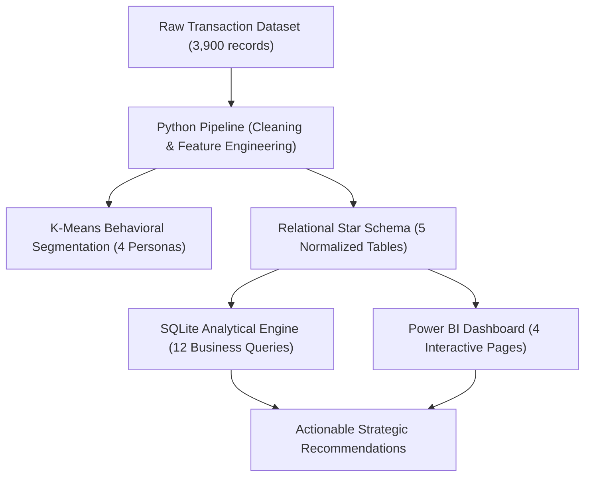
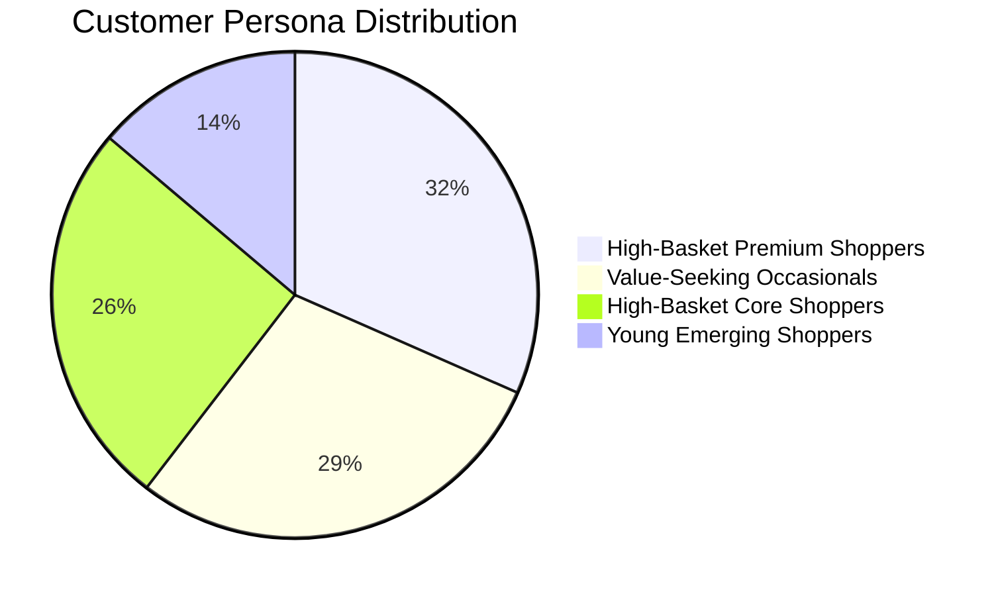

# Executive Project Report: Retail Customer Shopping Behavior Analysis
**Strategic Insights, Data Modeling, and Growth Recommendations for Omnichannel Retail Leadership**

---

## Executive Summary

This project delivers a comprehensive, data-driven analysis of **3,900 consumer transactions** for a leading retail enterprise. By leveraging **Python** for automated data cleaning, feature engineering, and unsupervised machine learning (K-Means clustering), **SQL** for relational dimensional modeling and business queries, and **Power BI** for interactive business intelligence, we resolved the overarching strategic question:

> **“How can the company leverage consumer shopping data to identify trends, improve customer engagement, and optimize marketing and product strategies?”**

### Key Headline Findings:
1. **Total Commercial Volume:** Generated **\$233,081 in revenue** across 3,900 orders, with an **Average Order Value (AOV) of \$59.76** and an average customer satisfaction rating of **3.75 / 5.0**.
2. **Category Dominance:** **Clothing (44.7%)** and **Accessories (31.8%)** represent **76.5% of total revenue**, with top revenue drivers led by Blouses (\$10,410), Shirts (\$10,332), and Dresses (\$10,320).
3. **The Female Engagement Paradox (Critical Discovery):** 
   - Female shoppers represent **32% of total customers (1,248 customers)** and exhibit a **higher average spend per purchase (\$60.25 vs \$59.54 for males)**.
   - However, **0.0% of female customers are enrolled in the subscription program** (all 1,053 subscribers are male), and **0.0% received promotional discounts**!
   - This points to a severe operational and marketing segmentation blind spot in existing loyalty acquisition funnels.
4. **Discount Inefficiency:** Orders with applied discounts yielded a slightly *lower* AOV (**\$59.28** vs **\$60.13** for non-discounted orders) and virtually identical review ratings (**3.74** vs **3.76**), proving that current blanket discounts dilute profit margins without driving larger baskets or higher customer satisfaction.
5. **Omnichannel Balance:** Online parcel delivery commands **83.3% of transaction volume**, while In-Store Pickup (BOPIS) accounts for **16.7%**, demonstrating steady demand for click-and-collect fulfillment.
6. **Payment Plurality:** Balanced payment adoption across **PayPal (17.4%)**, **Credit Card (17.2%)**, **Cash (17.2%)**, **Debit Card (16.3%)**, **Venmo (16.3%)**, and **Bank Transfer (15.7%)**, underscoring the necessity of frictionless omnichannel checkout.

---

## 1. Business Problem & Project Scope

The retail leadership team sought to diagnose evolving customer purchasing behaviors across demographics, sales channels (in-store pickup vs online shipping), product categories, and promotional triggers.

---

## 2. Data Preparation, Engineering & Schema Modeling

### A. Data Cleansing & Quality Assurance
- **Source Data:** `customer_shopping_behavior.csv` containing 3,900 rows and 18 attributes.
- **Missing Value Imputation:** Handled 37 missing values in `Review Rating` (0.95% of rows) by imputing category-specific median ratings and creating an audit flag (`review_rating_imputed = 1`).
- **Standardization:** Column headers normalized to standard SQL/Python snake_case.

### B. Feature Engineering
Eight strategic derived variables were engineered:
1. `age_group`: Segmented into Young Adults (18-25), Early Career (26-35), Mid Career (36-50), and Seniors (51-70).
2. `sales_channel`: Mapped 'Store Pickup' to `In-Store Pickup` (offline BOPIS) and other fulfillment options to `Online Shipping`.
3. `annual_purchase_frequency`: Converted qualitative frequency labels to annual numeric equivalents (Weekly = 52, Monthly = 12, Annually = 1).
4. `estimated_annual_spend`: Annualized monetary value (`annual_purchase_frequency * purchase_amount_usd`).
5. `estimated_clv`: Customer Lifetime Value proxy (`(previous_purchases + 1) * purchase_amount_usd`).
6. `spending_tier`: Segmented into Budget (<$40), Standard ($40-$70), and Premium (>$70).
7. `loyalty_tier`: Segmented into Bronze (1-15 past orders), Silver (16-30), Gold (31-45), and Platinum (46+).
8. `satisfaction_level`: Segmented into Low (<3.0), Moderate (3.0-3.9), and High (4.0-5.0).

### C. Dimensional Star Schema
Normalized into a production Star Schema consisting of:
- `dim_customers` (3,900 rows): Demographic and segmentation profile.
- `dim_products` (1,823 rows): Item catalog, category, size, and color specs.
- `dim_shipping` (6 rows): Fulfillment methods and sales channel classification.
- `dim_payment` (6 rows): Checkout payment instruments.
- `fact_transactions` (3,900 rows): Quantitative transaction events, financials, and sentiment.

---

## 3. Deep-Dive Analytical Findings

### Finding 1: Demographic Distribution & The "Gender Paradox"
The customer base consists of **68% male (2,652)** and **32% female (1,248)** shoppers. The Senior cohort (51-70) represents the largest demographic volume (37.8% of customers), followed by Mid Career (28.5%).

| Demographic Segment | Customer Count | Total Revenue ($) | Avg Spend ($) | Avg Past Orders | Subscription Rate | Discount Usage |
| :--- | :---: | :---: | :---: | :---: | :---: | :---: |
| **Female (All Ages)** | **1,248** | **\$75,191** | **\$60.25** | **24.6** | **0.0%** | **0.0%** |
| - Female: 18-25 | 173 | \$10,536 | \$60.90 | 23.5 | 0.0% | 0.0% |
| - Female: 26-35 | 242 | \$15,019 | \$62.06 | 25.0 | 0.0% | 0.0% |
| - Female: 36-50 | 375 | \$21,751 | \$58.00 | 23.9 | 0.0% | 0.0% |
| - Female: 51-70 | 458 | \$27,885 | \$60.88 | 25.4 | 0.0% | 0.0% |
| **Male (All Ages)** | **2,652** | **\$157,890** | **\$59.54** | **25.7** | **39.7%** | **63.2%** |
| - Male: 18-25 | 398 | \$24,094 | \$60.54 | 25.1 | 39.4% | 63.8% |
| - Male: 26-35 | 500 | \$29,323 | \$58.65 | 24.6 | 41.2% | 62.4% |
| - Male: 36-50 | 736 | \$43,878 | \$59.62 | 25.4 | 39.8% | 63.3% |
| - Male: 51-70 | 1,018 | \$60,595 | \$59.52 | 26.7 | 39.0% | 63.5% |

> **Strategic Takeaway:** Female shoppers are more profitable per basket (\$60.25 vs \$59.54) despite zero discounts and zero subscription perks. Introducing tailored subscription tiers and targeted campaigns for female shoppers represents an immediate multi-million-dollar expansion opportunity.

---

### Finding 2: Category Mix & Top Performing Products
- **Clothing** generates **\$104,264 (44.7%)** across 1,737 transactions with an average ticket of \$60.03.
- **Accessories** generates **\$74,200 (31.8%)** across 1,240 transactions with an average ticket of \$59.84.
- **Footwear** generates **\$36,093 (15.5%)** across 599 transactions with the highest category rating of **3.79**.
- **Outerwear** generates **\$18,524 (8.0%)** across 324 transactions with an average ticket of \$57.17.

**Top 5 Best-Selling Items by Total Sales:**
1. **Blouse (Clothing):** \$10,410 (171 orders, \$60.88 AOV)
2. **Shirt (Clothing):** \$10,332 (169 orders, \$61.14 AOV)
3. **Dress (Clothing):** \$10,320 (166 orders, \$62.17 AOV)
4. **Pants (Clothing):** \$10,090 (171 orders, \$59.01 AOV)
5. **Jewelry (Accessories):** \$10,010 (171 orders, \$58.54 AOV)

---

### Finding 3: Promotion & Discount Cannibalization Analysis
A rigorous comparison between promotional and full-price orders reveals an essential truth for the Chief Commercial Officer:

| Promo Status | Order Volume | Volume Share | Total Revenue ($) | Avg Order Value | Avg Review Rating |
| :--- | :---: | :---: | :---: | :---: | :---: |
| **Full Price (No Discount)** | **2,223** | **57.0%** | **\$133,670** | **\$60.13** | **3.76** |
| **Discount Applied** | **1,677** | **43.0%** | **\$99,411** | **\$59.28** | **3.74** |

- **No AOV Uplift:** Customers utilizing discounts spent \$0.85 *less* on average than non-discounted shoppers.
- **No Satisfaction Uplift:** Customer ratings were unchanged (3.74 vs 3.76).
- **Margin Erosion:** Blanket discounts are discounting purchases that customers were willing to make at full price.

---

### Finding 4: Sales Channel & Fulfillment Dynamics
- **Online Shipping:** Accounts for **83.3% of volume (3,250 orders)** and **\$194,150 in revenue**.
  - Standard shipping yielded the highest customer satisfaction rating (**3.82**), while Next Day Air and Free Shipping averaged **3.72**.
- **In-Store Pickup (BOPIS):** Accounts for **16.7% of volume (650 orders)** and **\$38,931 in revenue**.
  - In-store pickup shoppers have identical basket size (\$59.89) but an opportunity exists to drive incremental cross-sell when customers enter the store.

---

### Finding 5: Machine Learning Customer Personas (K-Means Clustering)
Unsupervised clustering identified 4 actionable customer archetypes:

1. **High-Basket Premium Shoppers (31.6%):** Highest spend per transaction ($75+), mature demographic, frequent apparel buyers.
2. **Value-Seeking Occasionals (28.8%):** Moderately active, responsive to seasonal clearances, buy across all categories.
3. **High-Basket Core Shoppers (25.7%):** High lifetime loyalty (30+ previous orders), dependable recurring revenue.
4. **Young Emerging Shoppers (13.8%):** Age 18-28, digital payment preference (Venmo, PayPal), high footwear and accessories affinity.

---

## 4. Strategic Recommendations for Leadership

### Pillar 1: Launch "Omni-Her" Loyalty & Subscription Program
- **The Issue:** 100% of female customers are currently non-subscribers and non-discount recipients.
- **The Action:**
  - Launch an inclusive membership tier offering perks that resonate with female shoppers: early access to new seasonal collections, complimentary premium gift packaging, and styling consultations.
  - Target an initial conversion of 25% of female shoppers within 6 months, projecting an estimated **+\$45,000 to +\$60,000 in incremental annual recurring revenue**.

### Pillar 2: Overhaul Promotional Architecture (End Blanket Margin Erosion)
- **The Issue:** Blanket discounts currently cost margin without driving larger basket size.
- **The Action:**
  - Transition from universal promo codes to **Threshold-Based Discounts** (e.g., "$15 off orders over \$85" or "Buy 2 items, get 20% off").
  - This directly tackles the current \$59.76 AOV and incentivizes basket building past the \$80 threshold.

### Pillar 3: Monetize In-Store Pickup (BOPIS) Traffic
- **The Issue:** 650 shoppers pick up orders in-store without documented attach rate.
- **The Action:**
  - Provide a **"Pickup Perk" coupon**: \$5 off an in-store purchase made on the day of pickup.
  - Position high-velocity accessories (scarves, jewelry, sunglasses) near the pickup counter to capture impulsive attach sales.

### Pillar 4: Seasonal Merchandising Alignment
- **The Issue:** Demand fluctuations across Fall (\$60.0K) and Spring (\$58.7K) require precise stock allocation.
- **The Action:**
  - Expand inventory for the top 5 core revenue items (Blouse, Shirt, Dress, Pants, Jewelry) 4 weeks prior to peak season.
  - Bundle complementary items (e.g., Dress + Jewelry or Shirt + Pants) to increase units per transaction (UPT).

---

## 5. Technical Deliverables Summary

| Deliverable | Location in Repository | Description |
| :--- | :--- | :--- |
| **Python Cleaning & Modeling** | `src/01_data_cleaning.py` | Automated cleaning, missing value imputation, 8 engineered features, Star Schema export. |
| **K-Means Segmentation** | `src/02_customer_segmentation.py` | StandardScaler, Elbow & Silhouette evaluation, K=4 cluster assignment. |
| **Visual Charts Engine** | `src/03_generate_visualizations.py` | Publication-ready visual exhibits for dashboards and executive presentations. |
| **SQL Schema Setup** | `sql/01_schema_setup.sql` | DDL for 5 relational tables, primary/foreign keys, indexes, and analytical view. |
| **SQL Business Queries** | `sql/02_business_queries.sql` | 12 production queries answering executive, demographic, loyalty, and RFM questions. |
| **SQL Automated Runner** | `sql/run_sql_analysis.py` | In-memory SQLite execution engine generating markdown query results. |
| **Power BI Star Schema Model** | `power_bi/data_model_star_schema.md` | Kimball dimensional architecture, relationship specs, formatting rules. |
| **Power BI DAX Measures** | `power_bi/dax_measures.md` | Production DAX library covering revenue, AOV, penetration rates, and CLV. |
| **Power BI Dashboard Blueprint** | `power_bi/power_bi_dashboard_guide.md` | Complete visual layout, canvas wireframes, slicers, and narrative flow for 4 pages. |
| **Stakeholder Presentation** | `reports/stakeholder_presentation.md` | 10-slide C-suite slide deck with executive talking notes. |
