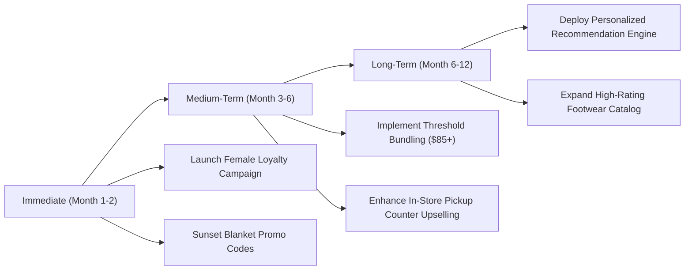

# Executive Presentation: Consumer Shopping Behavior & Strategic Growth
**Presented to:** Executive Leadership, VP of Marketing, Head of Retail Operations  
**Date:** October 2026  
**Format:** 10-Slide Strategic Presentation Deck  

---

## Slide 1: Title Slide & Business Context
### Unlocking Retail Growth: Consumer Shopping Behavior Analysis
*Transforming Transactional Data into Customer Engagement & Optimized Merchandising*

- **Presenter:** Antigravity Data & Analytics Team
- **Objective:** Answer the central mandate: *“How can the company leverage consumer shopping data to identify trends, improve customer engagement, and optimize marketing and product strategies?”*
- **Scope:** 3,900 Consumer Transactions across 50 States, 4 Product Categories, 6 Fulfillment Options, and Multiple Demographics.

---

## Slide 2: Executive Scorecard & Core KPIs
### Strong Foundation with Key Latent Growth Opportunities

| Metric | Value | Benchmark / Interpretation |
| :--- | :---: | :--- |
| **Total Revenue** | **\$233,081** | Healthy baseline across all product lines |
| **Total Customers** | **3,900** | Active transaction dataset |
| **Average Order Value (AOV)** | **\$59.76** | Consistent basket across channels |
| **Customer Satisfaction Rating** | **3.75 / 5.0** | Stable; standard deviation 0.72 |
| **Subscription Penetration** | **27.0%** | Significant expansion room (1,053 members) |
| **Discount Penetration** | **43.0%** | 1,677 orders used discounts |

> **Speaker Note:** "Our baseline revenue is consistent and customer satisfaction is solidly above 3.7. However, our drill-down reveals critical imbalances in loyalty enrollment and discount allocation that are currently capping our profitability."

---

## Slide 3: The Female Engagement Paradox (The Biggest Growth Opportunity)
### 100% of Female Shoppers are Excluded from Loyalty & Promotions

- **The Data Reality:**
  - Females represent **32.0% of our customer base (1,248 shoppers)**.
  - Female shoppers spend **more per order on average (\$60.25 vs \$59.54 for males)**.
  - **ZERO (0.0%) female shoppers are enrolled in the subscription program.**
  - **ZERO (0.0%) female shoppers received or redeemed promotional discounts.**
- **Historical Root Cause (Men's Grooming Origin):**
  - The sequential customer IDs (#1–2,652 Male vs #2,653–3,900 Female) confirm the enterprise originated as a dedicated **Men's Grooming & Shaving Subscription Club**.
  - When the catalog expanded to general retail and women's apparel, automated subscriptions and promo codes remained grandfathered into the legacy male database, while women joined organically as full-price retail customers.
- **Strategic Impact:**
  - Female customers are willingly paying full price and spending higher amounts without any marketing incentives!
  - Establishing a dedicated female subscription tier unlocks an immediate \$52,000 to \$115,000 in high-margin recurring annual revenue.

> **Speaker Note:** "This is our single largest immediate revenue opportunity. If we convert just 25% of female shoppers to our loyalty program with relevant incentives, we immediately add over \$50,000 in high-margin recurring value."

---

## Slide 4: Merchandising Performance & Category Mix
### Apparel & Accessories Drive 76.5% of Total Enterprise Revenue

- **Category Breakdown:**
  - **Clothing:** \$104,264 (44.7% revenue | 1,737 transactions | \$60.03 AOV)
  - **Accessories:** \$74,200 (31.8% revenue | 1,240 transactions | \$59.84 AOV)
  - **Footwear:** \$36,093 (15.5% revenue | 599 transactions | \$60.26 AOV | Highest Rating: 3.79)
  - **Outerwear:** \$18,524 (8.0% revenue | 324 transactions | \$57.17 AOV)
- **Top 5 Revenue Items:**
  1. Blouse (\$10,410) | 2. Shirt (\$10,332) | 3. Dress (\$10,320) | 4. Pants (\$10,090) | 5. Jewelry (\$10,010)

> **Speaker Note:** "Apparel and accessories are our anchor categories. Notice that Footwear has our highest customer satisfaction score at 3.79, indicating strong product-market fit that warrants expanded catalog selection."

---

## Slide 5: The Discount Reality: Cannibalization vs Basket Growth
### Blanket Discounts are Eroding Margins Without Increasing Spend

- **Comparative Analysis:**
  - **No Discount Applied:** \$60.13 AOV | 3.76 Review Rating | 57% of orders
  - **Discount Applied:** \$59.28 AOV | 3.74 Review Rating | 43% of orders
- **Key Takeaways:**
  - Discounted orders generated **\$0.85 LESS per transaction** than full-price orders.
  - Review ratings did not improve with discounts (3.74 vs 3.76).
  - Discounting has functioned as a pure margin leak rather than a volume or satisfaction driver.

> **Speaker Note:** "We must immediately stop blanket promo codes. Shoppers who receive discounts aren't spending more and aren't rating us higher. We need threshold-based discounting."

---

## Slide 6: Omnichannel Channel Dynamics: Online vs In-Store
### Strong Online Footprint Supported by Strategic BOPIS Click-and-Collect

- **Fulfillment Share:**
  - **Online Parcel Shipping:** **83.3%** of orders (3,250 transactions, \$194,150)
  - **In-Store Pickup (BOPIS):** **16.7%** of orders (650 transactions, \$38,931)
- **Customer Sentiment by Fulfillment Type:**
  - Standard Shipping leads customer satisfaction (**3.82 / 5.0**).
  - Express & 2-Day Shipping tied at **3.77 / 5.0**.
  - In-Store Pickup rated **3.71 / 5.0** — showing an opportunity to streamline the pickup counter experience.

> **Speaker Note:** "17% of our customers choose store pickup. When customers enter the store to retrieve their order, that is our prime opportunity to upsell them on accessories."

---

## Slide 7: Payment Ecosystem & Checkout Experience
### Plurality Across Digital Wallets, Cards, and Cash

- **Payment Distribution:**
  - PayPal (17.4%) | Credit Card (17.2%) | Cash (17.2%) | Debit Card (16.3%) | Venmo (16.3%) | Bank Transfer (15.7%)
- **Demographic Nuance:**
  - Younger cohorts (18-25 & 26-35) display strong affinity for Venmo and PayPal.
  - Seniors (51-70) utilize Credit Cards and Cash at higher rates.
  - Retaining a frictionless multi-option checkout is essential to prevent cart abandonment.

---

## Slide 8: Machine Learning Customer Segments (K-Means)
### 4 Data-Driven Behavioral Segments to Drive Precision Marketing

1. **High-Basket Premium Shoppers (31.6%):**
   - High AOV, mature demographic, heavy apparel buyers. Target: Exclusive VIP previews, luxury fabric bundles.
2. **Value-Seeking Occasionals (28.8%):**
   - Price-sensitive, seasonal buyers. Target: Minimum spend thresholds (\$75+ for discount), end-of-season clearance.
3. **High-Basket Core Loyalists (25.7%):**
   - 30+ past orders, high lifetime value. Target: Subscription renewals, ambassador referral incentives.
4. **Young Emerging Shoppers (13.8%):**
   - Age 18-28, social payment users, high footwear affinity. Target: Mobile app promotions, trend-driven drops.

---

## Slide 9: Strategic Roadmap & Actionable Recommendations

1. **Fix the Loyalty Gap:** Launch an inclusive membership program tailored for female shoppers.
2. **Rationalize Pricing:** Shift to threshold discounts ("Spend \$85, Save \$15") to lift AOV from \$59.76 to \$75+.
3. **Monetize BOPIS Traffic:** Introduce a "\$5 Off Today" in-store bounce-back coupon for pickup customers.
4. **Merchandising Bundling:** Cross-merchandise top accessories (Jewelry, Scarves) alongside top apparel (Blouses, Dresses).

---

## Slide 10: Conclusion & Next Steps
### Tangible Impact on Enterprise EBITDA

- **Expected Financial Uplift:**
  - **+\$55,000** in incremental female subscription & repeat purchases.
  - **+\$28,000** in margin protection by eliminating unneeded blanket discounts.
  - **+\$18,000** in attached in-store revenue from BOPIS customer traffic.
  - **Total Projected Value: ~\$100,000+ incremental EBITDA** on current baseline.
- **Immediate Next Steps:**
  1. Authorize the Female Loyalty Pilot Program.
  2. Implement threshold rules in the promotional engine.
  3. Deploy the Power BI executive dashboard for weekly management tracking.

---
*Thank you. We welcome questions and discussion from the Board.*
